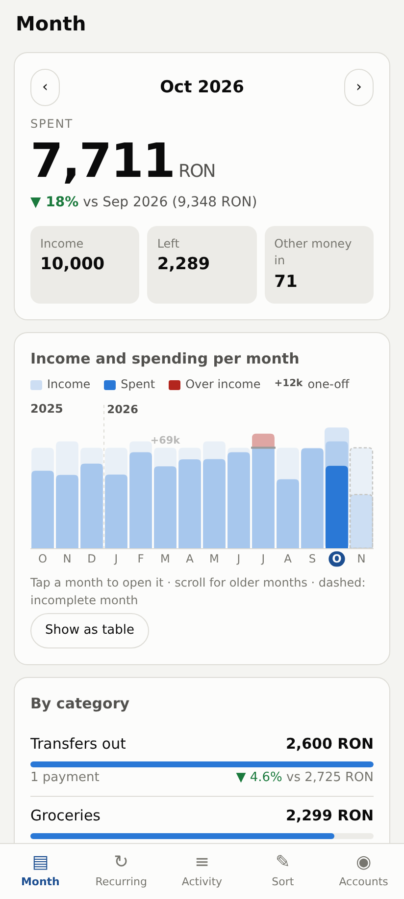
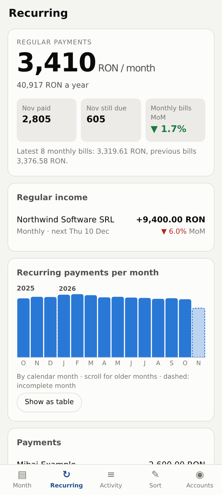
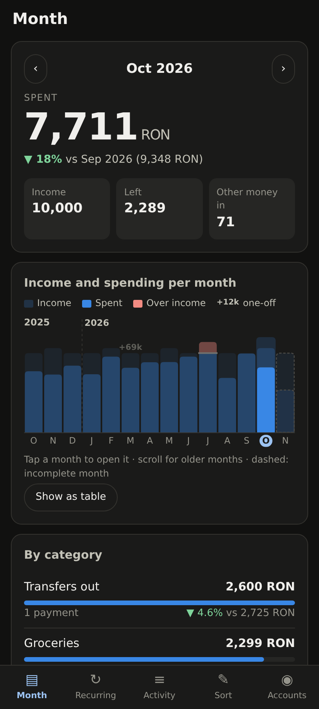
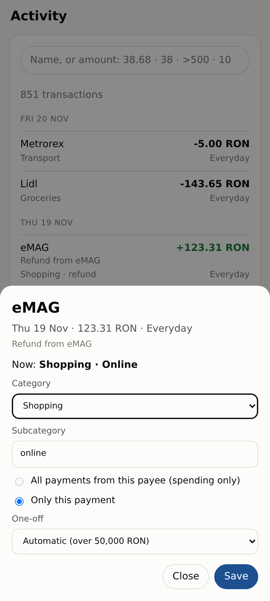
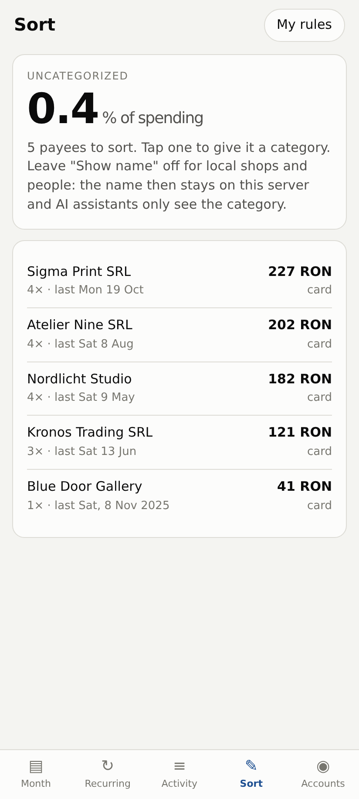
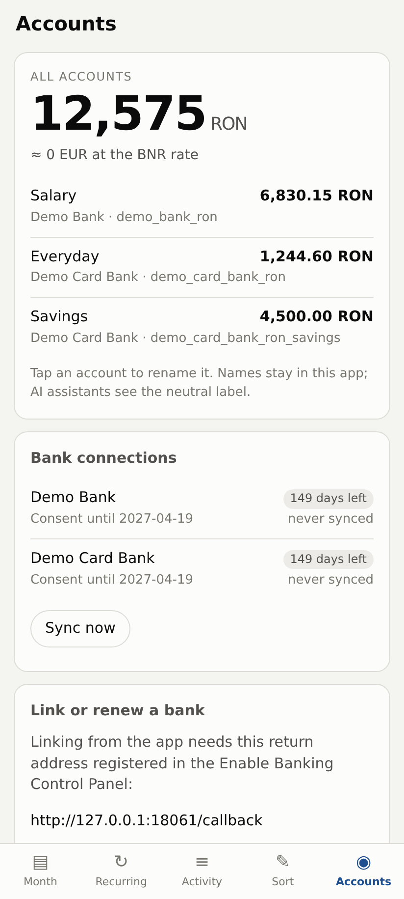

# Open Banking Hub

[](https://github.com/zandaulion/open-banking-hub/actions/workflows/tests.yml)
[](LICENSE)

**Bank Hub** is a self-hosted, read-only view of your own bank accounts. It pulls transactions from your banks
through the [Enable Banking](https://enablebanking.com) PSD2 API, keeps them in a SQLite file on
your own machine, and answers two questions well:

1. **Where did my money go?** Spending by category and payee, month by month, with transfers
   between your own accounts and very large one-off payments kept out of the totals.
2. **What am I paying regularly?** Subscriptions and bills, with the change from the previous
   bill, and your regular income.

It comes with an installable phone app (a PWA, for you only, on your private network) and a
read-only [MCP](https://modelcontextprotocol.io) server, so an AI assistant can answer questions
about your spending from a **redacted** view: categories, amounts and known merchants, never
people's names, IBANs or payment descriptions.

Built and tested with Revolut, ING Romania and BRD; any bank Enable Banking supports should work,
with bank-specific quirks described in [docs/BANKS.md](docs/BANKS.md).

> Bank Hub only ever **reads** account data (PSD2 AISP). It contains no code that can make a
> payment. It is not affiliated with Enable Banking or any bank. Use at your own risk.

<table>
  <tr>
    <td align="center"><br><strong>Month</strong></td>
    <td align="center"><br><strong>Recurring</strong></td>
    <td align="center"><br><strong>Dark mode</strong></td>
  </tr>
  <tr>
    <td align="center"><br><strong>A payment</strong></td>
    <td align="center"><br><strong>Sort</strong></td>
    <td align="center"><br><strong>Accounts</strong></td>
  </tr>
</table>

All screenshots use made-up data from `bankhub demo`.

## Try it without a bank

```bash
uv sync
export BANKHUB_DATA_DIR=/tmp/bankhub-demo
uv run bankhub demo                      # a year of made-up transactions
uv run bankhub invite --label demo       # prints a link
uv run bankhub web                       # open the link on this machine
```

## What you need

- A Linux machine that stays on (a small VPS or a home server), with Python 3.11+ and
  [uv](https://docs.astral.sh/uv/).
- A private network to reach it from your phone. [Tailscale](https://tailscale.com) is the
  easiest; the app should **not** be exposed to the public internet.
- An [Enable Banking](https://enablebanking.com) account. Its *restricted production* mode is free
  for private individuals and gives access to the accounts you link yourself.

## Setup

### 1. Install

```bash
git clone https://github.com/zandaulion/open-banking-hub.git && cd open-banking-hub
uv sync
uv run bankhub init
```

`init` creates your private data directory (`~/.local/share/bankhub`, or `$BANKHUB_DATA_DIR`),
generates a signing key and prints its **public** key. Everything personal lives in that
directory: settings, key, database, rules and backups. It is never part of the repository.

### 2. Register with Enable Banking

In the [Control Panel](https://enablebanking.com/cp) → **API applications** → register a new
application:

- Environment: **Production**.
- Key: **provide your own public key**, and paste the one `init` printed.
- Redirect URLs: `https://enablebanking.com/` and `<your app address>/callback`
  (see step 4 for the address).
- Description, data-protection email, privacy-policy and terms URLs: required; for personal use
  any page you control will do.

Then **Link accounts** for every bank you want. In restricted mode the API only returns accounts
linked here, so a bank you skip will return zero accounts. Some banks need a specific order of
steps; see [docs/BANKS.md](docs/BANKS.md).

```bash
uv run bankhub init --app-id <application ID> --base-url https://<your-machine>.<your-tailnet>.ts.net:8446
```

### 3. Run it

**With Docker Compose** (the data lives in a volume; the app is published on 127.0.0.1 only):

```bash
docker compose run --rm app bankhub init                    # prints the public key for step 2
docker compose run --rm app bankhub init --app-id <id> --base-url <your app address>
docker compose up -d                                        # the app, plus twice-daily sync and nightly backup
docker compose exec app bankhub invite --label phone
```

**With systemd** (no Docker):

The repository has systemd user units in `deploy/`. Copy them, replace `/path/to/...`, and enable:

```bash
cp deploy/bankhub-web.service deploy/bankhub-sync.{service,timer} \
   deploy/bankhub-backup.{service,timer} ~/.config/systemd/user/
# edit the paths in the copied files, then:
systemctl --user daemon-reload
systemctl --user enable --now bankhub-web.service bankhub-sync.timer bankhub-backup.timer
loginctl enable-linger "$USER"     # keep user services running after you log out
```

The app listens on `127.0.0.1:8041` only.

### 4. Publish it on your private network

With Tailscale, serve it on its own HTTPS port of your machine's tailnet name:

```bash
tailscale serve --bg --https=8446 http://127.0.0.1:8041
```

Your app address is then `https://<your-machine>.<your-tailnet>.ts.net:8446`, the value for
`--base-url` above. Other options, including Caddy under a sub-path, are in
[docs/DEPLOY.md](docs/DEPLOY.md).

### 5. Register your phone

```bash
uv run bankhub invite --label phone
```

Open the printed link on your phone (connected to your private network), tap **Activate this
device**, then add it to your home screen. Each invitation registers exactly one device and
expires after 7 days. `uv run bankhub devices` lists devices; `--revoke <id>` cuts one off.

### 6. Link your banks

In the app: **Accounts → Link or renew a bank**. You approve in your bank's own app and come back
to Bank Hub, which immediately imports as much history as the bank allows (often only available
right after approval). Consents last up to 180 days; Accounts warns before they expire.

From the terminal instead: `uv run bankhub auth start <bank>`, then
`uv run bankhub auth finish '<the address you land on>'`.

## Using it

- **Month**: spending so far vs the same days of last month, income and what is left, categories,
  top payees, one-offs, and a scrollable chart of every month.
- **Recurring**: subscriptions and bills with month-over-month change, what is still due this
  month, and regular income.
- **Activity**: every transaction; search by name or by amount (`38.68`, `>500`, `100-200`).
  Tap one to change its category, for that payment or for every payment to that payee, or to mark
  it as a one-off.
- **Sort**: unrecognised payees, biggest first. Give each a category, and choose whether its
  name may be shown to AI assistants (keep it off for people and small local shops).

Syncs run twice a day (`bankhub sync`), within the PSD2 limit of about four unattended requests
per account per day. Terminal reports: `bankhub report month`, `bankhub report recurring`.

### Ask an AI assistant

```bash
claude mcp add bankhub -- /path/to/open-banking-hub/.venv/bin/bankhub mcp
```

Tools: `get_sync_status`, `get_balances`, `query_transactions`, `get_spending_summary`,
`get_recurring_payments`. The server opens the database read-only and reads only the redacted
tables. Check what an assistant can see with `bankhub inspect-redaction --samples 0`.

### Your own rules

Categories come from `src/bankhub/data/categories.yaml` (Romanian and international merchants).
Your own rules live in `<data dir>/categories.yaml`, are checked first, and are what the app's
Sort and Activity screens write to. Merchants listed there are shown by name; `category_rules`
set a category without ever naming the payee.

## Backups

`bankhub-backup.timer` takes a nightly, integrity-checked snapshot of everything in the data
directory (14 kept). For an encrypted off-site copy, `deploy/offsite-backup.sh` wraps
[restic](https://restic.net) over SFTP; see [docs/DEPLOY.md](docs/DEPLOY.md). Keep the restic
password somewhere other than the machine itself.

## Deploying with an AI agent

Point it at [AGENTS.md](AGENTS.md); the step-by-step procedure, including what to ask you and what
never to do, is in [.claude/skills/deploy/SKILL.md](.claude/skills/deploy/SKILL.md).

## Development

```bash
uv run pytest
```

See [CONTRIBUTING.md](CONTRIBUTING.md) and [SECURITY.md](SECURITY.md).

All test data is synthetic. A test refuses commits that contain real-looking IBANs, private
hostnames, email addresses or keys. The design is described in [docs/DESIGN.md](docs/DESIGN.md).

## License

[MIT](LICENSE). The PWA update helpers in `src/bankhub/web/static/` come from
[pwa-kit](https://github.com/zandaulion/pwa-kit), also MIT.
