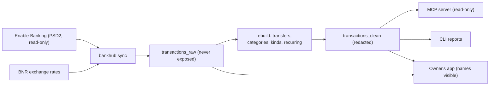

# Design



## Principles

- **Read-only.** Only account-information endpoints are used; there is no payment code path.
- **Self-hosted.** Data, keys and settings stay in one private directory on your machine.
- **Two audiences, two views.**
  - The owner's app shows real names and descriptions, to registered devices only.
  - AI assistants get the redacted ledger only: an allowlist of columns, merchants named only
    when they match a rule, people never named, descriptions never included.
- **Nothing is counted twice.** Moves between your own accounts are detected and kept out of
  spending and income.
- **Deterministic.** Syncing and categorization use rules, not language models.

## Data flow

1. **Sync** fetches balances and transactions per account. On the first sync after a consent it
   asks for the longest history available. Afterwards it fetches the last few days, with an
   overlap to catch late bookings. Pending card payments are replaced once they settle. A daily
   request budget per account stays within PSD2 limits. Banks that truncate long lists are
   fetched in date windows (see [BANKS.md](BANKS.md)).
2. **Normalize** turns each bank's payload into canonical fields: signed amount in minor units,
   currency, dates, counterparty name and IBAN, whether the counterparty has an account (a
   transfer) or not (a card payment), description, and the bank's transaction type. Some banks
   need their own reader.
3. **Rebuild** (after every sync, or `bankhub rebuild`) recomputes the derived tables from the raw
   ones: own transfers, categories, kinds, one-offs and recurring series. It sends no bank
   requests, so it can be rerun freely after rule changes.

## Own transfers

In this order:

- **Same reference on two of your accounts** with opposite directions (Revolut pockets).
- **One-sided rules:** the counterparty IBAN is one of yours, the description or payee matches an
  `own_account_patterns` rule (pocket moves, card top-ups), or the bank's transaction type is
  marked `internal` (term deposits).
- **Amount matching across banks:** opposite directions, 0–3 days apart, within ±2% after
  conversion to RON at the BNR rate (Revolut converts at its own rate and charges fees). You can
  confirm or reject these.

## Categories and kinds

Every transaction has a **category** (groceries, utilities, loans…) and a **kind**:

| Kind | Meaning | Counted as |
|---|---|---|
| `spending` | money out | spending |
| `refund` | a known merchant paying you back | reduces spending in that merchant's category |
| `income` | regular money in from one payer (salary), and interest | income |
| `other_in` | other money in (people paying you back, unknown) | other money in |
| `one_off` | at or above the one-off threshold, or marked by hand | kept out of totals, shown apart |
| `internal` | a move between your own accounts | nothing |
| `dependent` | a payment on an account in a group (someone else's money) | nothing (shown, not counted) |

Categories come from the first rule that matches, in this order:

1. the bank's transaction type (`bank_code_rules`);
2. known merchants;
3. labels such as cash, fees and interest;
4. keyword `category_rules`, which never name the payee.

Bank transfers are matched on the counterparty name only, never on the free-text message, which
can contain anyone's name. Merchants whose names are also first names are `card_only`. Your own
rules are checked before the packaged ones. Per-transaction overrides win over everything.

## Account groups

Accounts that hold someone else's money (a child's, a parent's, a business) go in a group. A group's own
payments are shown but not counted, and its balance is reported apart from your total. Money between a
group's accounts and yours is found by shared reference, IBAN, the same amount in opposite directions
within two days, and the counterparty names seen in those matches. How it counts depends on the group:

| Behaviour | Money you send | Money back |
|---|---|---|
| `supported` (someone I support) | spending, in the group's category | other money in, or a refund in that category |
| `separate` (kept separate) | a transfer (not counted), or spending | the same: a transfer, or other money in |

Group names stay in the owner's app (`account_groups`, `transaction_groups`); the redacted ledger carries
only the category.

## Recurring payments and income

Payments are grouped by payee and then by similar amounts. A group is recurring when most
intervals fit a cadence: weekly (6–8 days), monthly (26–34) or annual (350–380). Metered bills
(utilities, building fees) are monthly whatever the amount. The change shown is the latest bill
against the previous one: month-over-month, or year-over-year for annual payments. Regular money
in from one payer, at least 100 RON a month, is income.

## Privacy boundary

`transactions_clean` has a fixed set of columns, enforced by a test:

```
id, account_alias, booking_date, value_date, amount, currency, amount_ron, direction, status,
merchant, counterparty_type, category, subcategory, is_internal_transfer, is_recurring, kind,
is_one_off
```

`merchant` is a known merchant's name, or a label: `individual`, `unknown_merchant`,
`unnamed_merchant`, `own_account`, `cash_withdrawal`, `bank_fee`. `bankhub inspect-redaction`
scans the agent-facing tables for IBANs, card numbers, personal IDs, emails, phone numbers and
any raw counterparty name, and must print `PASS`.

The MCP server opens the database with `mode=ro` and calls only `bankhub.queries`, which reads
the redacted tables. No tool accepts SQL.

## The owner's app

FastAPI on loopback, a static PWA with no build step (self-updating service worker from pwa-kit),
and its own `web.db` for invitations and devices.

- **Devices:** a one-time code registers a device, which then holds a random token in an
  HttpOnly cookie. Only the token's hash is stored.
- **Requests:** writes need a custom header, and responses carry a strict CSP and are never
  cached.
- **Bank linking:** `/callback` accepts only a state that this device started in the last hour.
- **Import:** runs in the background, so the phone is not left waiting.

## Alerts

After every sync, `bankhub/web/alerts.py` checks:
- a payment at or above an amount, counting only transactions stored after alerts were turned on;
- the total of RON accounts below an amount;
- regular income marked missed;
- a regular payment whose amount changed;
- a consent ending within 14, 7, 3 or 0 days;
- a bank with no successful sync for two days;
- a local backup older than two days.

Each alert has a stable key and is sent once, as Web Push (VAPID key in `secrets/vapid.pem`), to every
registered device that turned notifications on. Only the push services of Chrome, Firefox, Edge and
Safari are accepted as endpoints. The text leaves out amounts and payees unless the owner turns
details on.

## Exchange rates

Daily rates from the National Bank of Romania (`curs.bnr.ro`), fetched per year and only when
foreign-currency transactions need them. Weekends and holidays use the last published rate.
